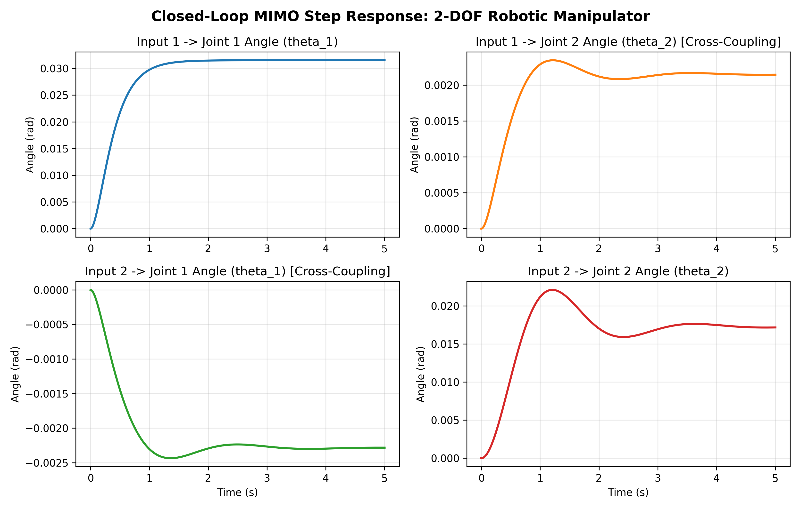

# 2-DOF Robotic Manipulator Arm: MIMO Linear & Nonlinear Control System

[](https://www.mathworks.com/products/simulink.html)
[](https://www.python.org/)
[](LICENSE)
[](#system-modeling--state-space-representation)

A comprehensive study, mathematical modeling, and control system design for a **2-Degree-of-Freedom (2-DOF) planar robotic manipulator arm**. This repository contains state-space linearization, stability and controllability analyses, decentralized PID frequency-domain shaping, full-state feedback pole placement (LQR), Simulink dynamic simulations (both linear and nonlinear), 3D multi-body animation, and a standalone Python verification suite.

---

## Table of Contents
- [System Modeling & State-Space Representation](#system-modeling--state-space-representation)
- [Open-Loop Stability & Controllability Analysis](#open-loop-stability--controllability-analysis)
- [Control Strategies](#control-strategies)
  - [1. Full-State Feedback Pole Placement](#1-full-state-feedback-pole-placement)
  - [2. Decentralized PID Control with Derivative Filtering](#2-decentralized-pid-control-with-derivative-filtering)
- [Simulation Results](#simulation-results)
- [Repository Structure](#repository-structure)
- [Quick Start](#quick-start)
  - [Standalone Python Simulation](#standalone-python-simulation)
  - [MATLAB & Simulink Execution](#matlab--simulink-execution)
- [References & Documentation](#references--documentation)

---

## System Modeling & State-Space Representation

The 2-DOF robotic manipulator arm consists of two revolute joints subject to coupled nonlinear inertial, Coriolis, and gravitational dynamics:

$$M(\theta)\ddot{\theta} + C(\theta, \dot{\theta})\dot{\theta} + G(\theta) = \tau$$

Where:
- $\theta = [\theta_1, \theta_2]^T$: Joint angular displacements (rad).
- $\dot{\theta} = [\dot{\theta}_1, \dot{\theta}_2]^T$: Joint angular velocities (rad/s).
- $\tau = [\tau_1, \tau_2]^T$: Actuator input torques (N·m).

Linearizing around the nominal equilibrium point $\theta_0 = [0, 0]^T, \dot{\theta}_0 = [0, 0]^T$ yields the state vector $x = [\theta_1, \theta_2, \dot{\theta}_1, \dot{\theta}_2]^T$, input vector $u = [\tau_1, \tau_2]^T$, and output vector $y = [\theta_1, \theta_2]^T$:

$$\dot{x}(t) = A x(t) + B u(t)$$
$$y(t) = C x(t) + D u(t)$$

With numerical parameters:

$$A = \begin{bmatrix} 0 & 0 & 1 & 0 \\ 0 & 0 & 0 & 1 \\ -0.4568 & -0.6196 & 0 & 0 \\ 0.2485 & -6.6174 & 0 & 0 \end{bmatrix}, \quad B = \begin{bmatrix} 0 & 0 \\ 0 & 0 \\ 0.7870 & -0.0426 \\ 0.04285 & 0.1349 \end{bmatrix}$$

$$C = \begin{bmatrix} 1 & 0 & 0 & 0 \\ 0 & 1 & 0 & 0 \end{bmatrix}, \quad D = \begin{bmatrix} 0 & 0 \\ 0 & 0 \end{bmatrix}$$

---

## Open-Loop Stability & Controllability Analysis

### 1. Eigenvalues and Open-Loop Poles
The characteristic polynomial $\det(\lambda I - A) = 0$ yields two pairs of undamped imaginary eigenvalues:
- $\lambda_{1, 2} = \pm 0.6942j$ (Joint 1 slow oscillatory mode)
- $\lambda_{3, 4} = \pm 2.5675j$ (Joint 2 fast oscillatory mode)

Because all real parts are zero ($\operatorname{Re}(\lambda_i) = 0$), the open-loop system is **marginally stable** (undamped harmonic oscillations without external damping) and requires closed-loop feedback stabilization.

### 2. Controllability
The controllability matrix $\mathcal{C}$ is given by:

$$\mathcal{C} = \begin{bmatrix} B & AB & A^2 B & A^3 B \end{bmatrix} \in \mathbb{R}^{4 \times 8}$$

$$\operatorname{rank}(\mathcal{C}) = 4 = n$$

Since $\operatorname{rank}(\mathcal{C})$ equals the state dimension, the system is **completely state controllable**, confirming that any arbitrary closed-loop pole configuration can be assigned via state feedback.

---

## Control Strategies

### 1. Full-State Feedback Pole Placement
A linear state-feedback control law $u(t) = -K x(t) + K_r r(t)$ is formulated. Using continuous algebraic Riccati optimization with state penalty $Q = \operatorname{diag}(100, 100, 10, 10)$ and input cost $R = 0.1 I_{2\times 2}$, the gain matrix $K$ is computed:

$$K = \begin{bmatrix} 30.9732 & 0.7805 & 13.3075 & 1.2154 \\ -1.9260 & 9.4326 & -1.3495 & 15.3825 \end{bmatrix}$$

The resulting closed-loop system matrix $A_{\text{cl}} = A - BK$ places all poles deep in the open left-half complex plane:
- $\lambda_{1} = -6.9579$
- $\lambda_{2} = -3.5863$
- $\lambda_{3, 4} = -1.0567 \pm 2.6014j$

### 2. Decentralized PID Control with Derivative Filtering
For practical single-loop industrial implementations, decentralized PID controllers with first-order high-frequency noise filters are designed:

$$C_i(s) = K_p + \frac{K_i}{s} + K_d \frac{N}{1 + N \frac{1}{s}}$$

- **Channel 1 (Joint 1):** $K_p = 52.33, \; K_i = 20.0, \; K_d = 35.0, \; N = 1426.56$
- **Channel 2 (Joint 2):** $K_p = 1340.81, \; K_i = 907.50, \; K_d = 455.42, \; N = 2260.94$

---

## Simulation Results

The closed-loop MIMO step response demonstrates rapid tracking convergence, zero steady-state error, and effective suppression of dynamic cross-coupling between Joint 1 and Joint 2:



A high-fidelity 3D visualization of the arm trajectory is included in [`media/Simulation3D.mp4`](media/Simulation3D.mp4).

---

## Repository Structure

```
07_2DOF_Linear_Control_System/
├── docs/
│   ├── Control_System_Project_Specification.pdf  # Academic problem formulation
│   └── 2DOF_Robotic_Arm_Project_Report_FA.pdf    # Original technical report
├── matlab/
│   ├── LCproj.m                                 # MATLAB pole placement, Root Locus, Bode, & Nyquist
│   └── treee.m                                  # Simscape / robotics toolbox import script
├── media/
│   └── Simulation3D.mp4                         # 3D kinematic simulation recording
├── results/
│   └── closed_loop_step_response.png            # Step response validation plot
├── simulink/
│   ├── LCnonlinear.slx                          # Full nonlinear plant simulation with feedback
│   ├── Simulation2DOF.slx                       # Multi-body physical model block diagram
│   └── Simulink2DOF.slx                         # State-space linearized closed-loop model
├── simulate_system.py                           # Standalone Python simulation & validation runner
├── requirements.txt                             # Python dependencies (NumPy, SciPy, Matplotlib)
├── .gitignore
└── README.md
```

---

## Quick Start

### Standalone Python Simulation
To verify the system stability, controllability, state-feedback gain matrices, and generate the MIMO step response without needing a MATLAB license:

```bash
pip install -r requirements.txt
python simulate_system.py
```

### MATLAB & Simulink Execution
1. Open MATLAB (R2022b or newer).
2. Add the repository directory to your MATLAB path.
3. Run `matlab/LCproj.m` to view the transfer function matrices, root loci, and frequency responses.
4. Open and run `simulink/Simulink2DOF.slx` or `simulink/LCnonlinear.slx` for interactive time-domain inspection.

---

## References & Documentation
- Ogata, K. *Modern Control Engineering*, 5th Edition, Prentice Hall.
- Craig, J. J. *Introduction to Robotics: Mechanics and Control*, Pearson.
